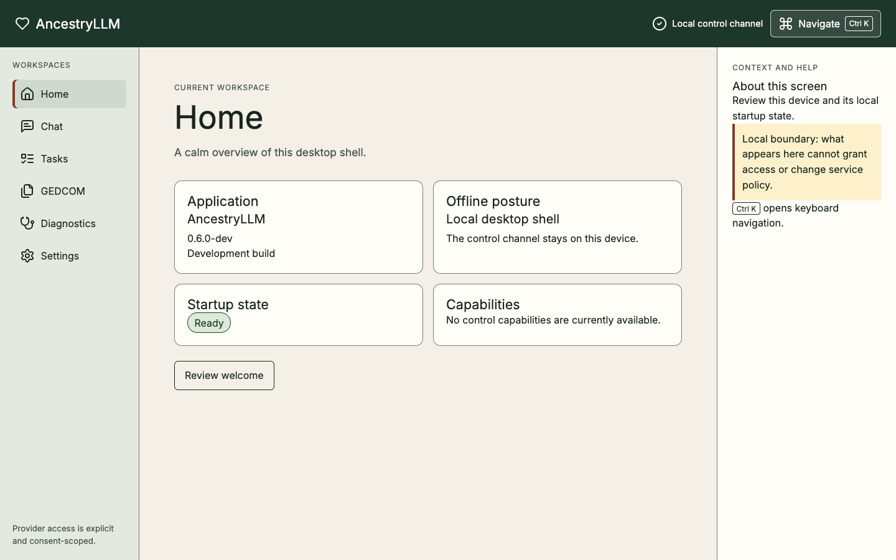

# Desktop first run

This tutorial covers the supported 0.6.0 desktop installer: Home, Diagnostics,
local visual Settings, and onboarding. You will reach a local Home state with
`provider=none` and no network request. Tasks, Chat, provider configuration,
and file-grant adapters remain source-level gates outside this installer claim.

## Before you begin

Install and verify a supported, target-matched 0.6.0 build using
[Installation and updates](../explanation/DESKTOP_SHELL.md#installation-and-updates).
The desktop is local-first: its
private sidecar is a **Local control channel**, not a public or LAN API. You do
not need an account, provider, API key, genealogy file, or cloud consent for
this tutorial.

The screenshots illustrate the steps with deterministic fictional fixtures.
Your installed application reports its own sanitized local startup state.
The illustrations contain no local paths, secrets, genealogy records, prompts,
responses, or provider payloads. Do not load real genealogy data or credentials
to reproduce them. For fixture previews, use the separate development procedure
at the end of this page.

## 1. Choose the local desktop

1. Start AncestryLLM.
2. On **Welcome to AncestryLLM**, review the three deployment choices.
3. Keep **Local Desktop (Recommended)** selected.
4. Confirm that **Connect Remote** and **Host Remote** say **Not available in
   this release**.

Local Desktop uses the private loopback sidecar and offline-first defaults.
Selecting it does not discover a remote service, start a container, open a
listener, configure a provider, or grant cloud consent.

## 2. Review startup checks

The welcome screen evaluates four sanitized startup components:

- **Configuration**
- **Encrypted database support**
- **Credential storage**
- **Local workspace**

A healthy report enables **Continue to Home**. Choose it to record only that
onboarding is complete, then wait for the Home heading to receive focus.

If a required component is blocked, choose **Open read-only diagnostics**
instead. The degraded application remains navigable, but it will not mutate
preferences, settings, credentials, or storage. Follow only the remediation
beside the stable code; never create a replacement database, reveal a local
path, or fall back to plaintext storage.

## 3. Confirm the local Home state

On Home, confirm the following cards are present:

- **Application** identifies the desktop build.
- **Offline posture** reports the local-first boundary.
- **Startup state** reports **Ready** after healthy startup checks. If it does
  not, follow the diagnostics recovery in step 2.
- **Capabilities** contains only sanitized capability metadata.



The shell must still be safe when credentials happen to exist in the
environment: `provider=none` remains network-free and ambient credentials do
not select a provider. No provider SDK, genealogy file, or cloud consent is
needed to reach this result.

## 4. Explore without granting authority

Use the primary navigation to visit **Diagnostics** and **Settings**, then
return to **Home**. Visiting these destinations does not select a provider,
start genealogy work, or disclose data.

Press <kbd>Ctrl</kbd>+<kbd>K</kbd> on Windows or Linux, or
<kbd>Command</kbd>+<kbd>K</kbd> on macOS, to open **Go to a workspace**. Type a
destination in **Filter destinations**, press <kbd>Escape</kbd> to dismiss the
dialog, and confirm focus returns to the trigger. Keyboard users can use
**Skip to workspace** to move directly to the current heading.

## 5. Revisit the welcome screen

On Home, choose **Review welcome**. This is temporary presentation state; it
does not reset settings or change the saved onboarding preference. Choose
**Back to Home** when finished.

## Result and next steps

After healthy startup checks, you have a provider-none, network-free desktop
Home state without loading genealogy data. Continue according to your goal:

- Use [Recover with desktop diagnostics](../how-to/desktop-diagnostics.md) if
  startup is degraded.
- Read the [Desktop reference](../reference/DESKTOP.md) for destinations,
  states, keyboard behavior, and stable codes.
- Use the [CLI reference](../reference/CLI.md) for one-shot genealogy commands.
- Use the [interactive console](../CONSOLE.md) for the prompt-toolkit/Rich
  genealogy session.

The CLI and interactive console own the supported genealogy workflows. The
desktop shell does not silently gain file, provider, network, or genealogy
authority by sharing their application contracts.

## Optional: preview fictional development fixtures

For source development, follow the
[desktop setup and gates](https://github.com/sodejm/AncestryLLM/blob/main/desktop/README.md#reproducible-setup-and-gates),
then run this command from the repository root:

```sh
pnpm --dir desktop dev:gallery
```

The gallery uses fictional presentation fixtures. It does not verify an
installed application's startup state or establish support for a release.
Keep real family trees, credentials, prompts, responses, databases, backups,
and logs out of this preview. The production build excludes gallery fixtures.

The [desktop source-level guides](../Home.md#desktop-source-level-guides)
describe the gated file, provider, Tasks, and Chat contracts. A development
preview does not replace their target-matched packaged and security evidence.
